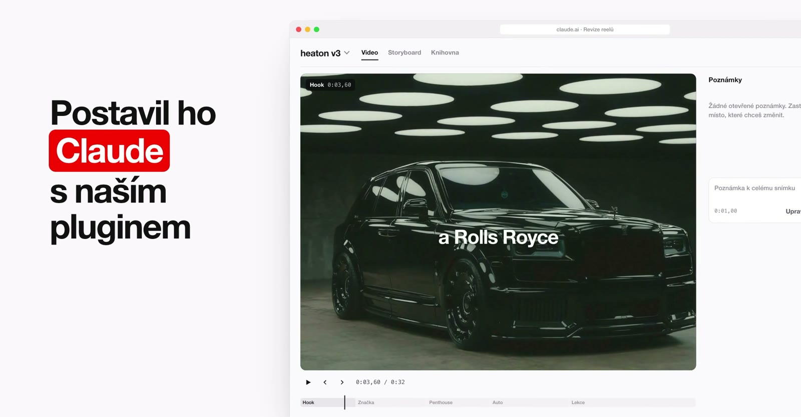
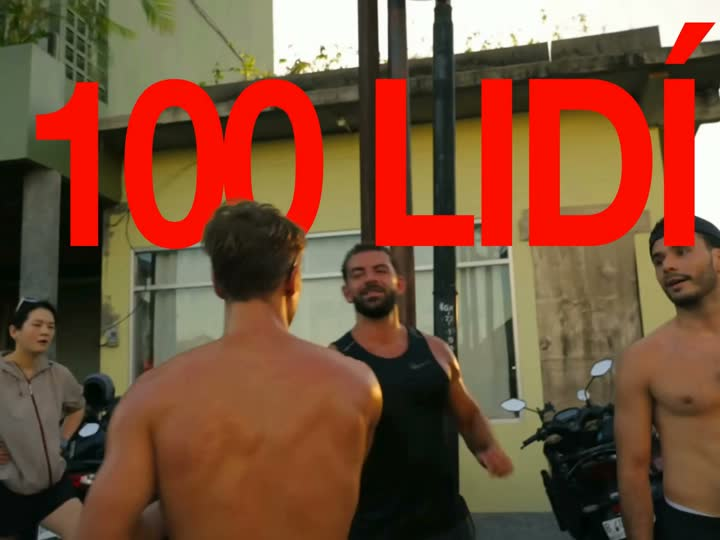
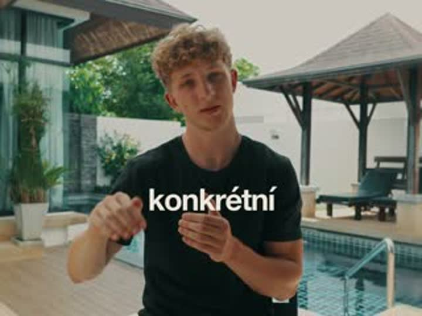
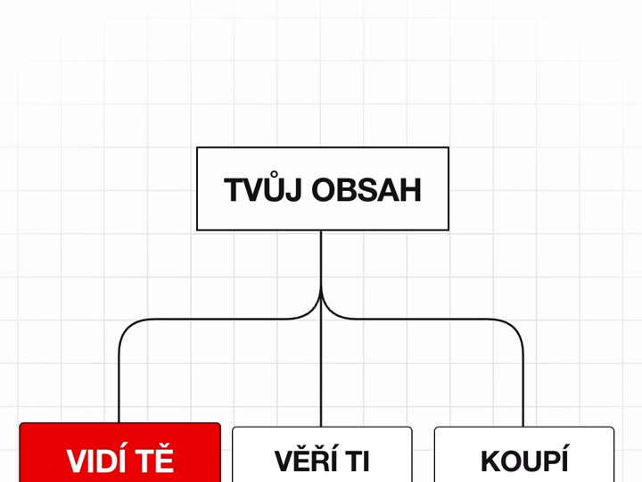
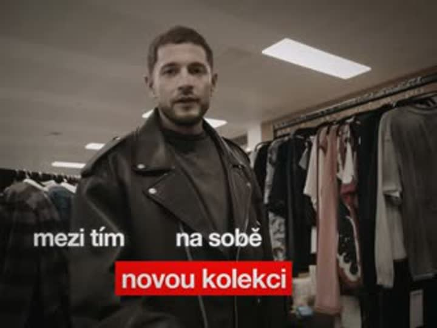
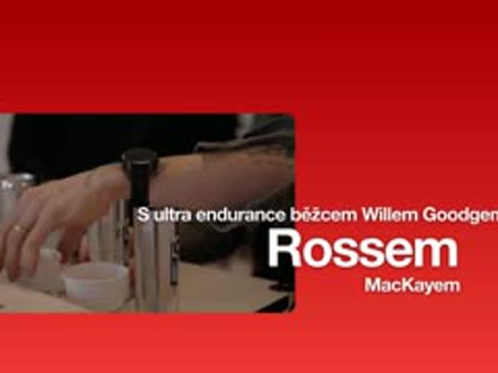

<p align="center">
  <a href="docs/media/film.mp4"></a>
</p>

<h1 align="center">beyond / reels</h1>

<p align="center">
  Plugin pro Claude Code, se kterým tým Beyond dělá reely v HyperFrames.<br>
  Pošleš video a řekneš styl. Claude se doptá, navrhne směry, postaví reel, smíchá zvuk a dá ho na revizi.
</p>

<p align="center">
  <a href="#instalace"><b>Instalace</b></a> &nbsp;·&nbsp;
  <a href="#jak-vznik%C3%A1-reel">Jak vzniká reel</a> &nbsp;·&nbsp;
  <a href="#styly">Styly</a> &nbsp;·&nbsp;
  <a href="#%C5%99e%C5%A1en%C3%AD-probl%C3%A9m%C5%AF">Řešení problémů</a> &nbsp;·&nbsp;
  <a href="docs/media/film.mp4">Film o pluginu, 42 s</a>
</p>

<br>

## Instalace

Jednou na každém Macu s Apple čipem, asi deset minut. Potřebuješ [Homebrew](https://brew.sh) a přístup k tomuhle repu (napiš Štěpánovi svůj GitHub).

**1. Přihlas se do GitHubu** v Terminálu, repo je soukromé:

```bash
brew install gh && gh auth login && gh auth setup-git
```

**2. Přidej plugin** v Claude Code:

```
/plugin marketplace add StepanKakes/beyond-reels
/plugin install beyond-reels@beyond
```

**3. Spusť setup.** Nainstaluje nástroje a Python, stáhne hudbu a B-rolly (1 GB), model pro přepisy a vytáhne Helvetica Neue ze systému tvého Macu:

```bash
zsh ~/.claude/plugins/marketplaces/beyond/plugins/beyond-reels/scripts/setup.sh
```

**4. Restartuj Claude Code** a napiš `/beyond-reels:reel`.

> [!TIP]
> Revize běží na stránce [Revize reelů](https://claude.ai/artifact/NCnPwTFvfcjDD8PfuyNQH2). O přístup s úpravami požádej Štěpána, bez něj nejdou komentáře ani knihovna komponent.
> Text za lidmi (obří slovo za osobou) potřebuje navíc MatAnyone2, asi 2,5 GB: setup s `--matanyone`, až ho budeš poprvé potřebovat.

<br>

## Jak vzniká reel

Osm kroků. Ve čtyřech rozhoduješ ty a render přijde až po schváleném storyboardu.

| | Krok | Kdo | Co se děje |
|:-:|---|---|---|
| 1 | **Video a styl** | ty | cesta k videu nebo víc pokusů, o kom to je, jaký styl |
| 2 | **Brief** | Claude | doptá se na typ, délku a konec, založí projekt v `~/Documents/beyond-reely` |
| 3 | **Text, střih a hlas** | Claude | přepis, nejlepší pokusy, hrany do ticha, studio hlas a časy slov |
| 4 | **Výběr směrů** | ty | u každé důležité věty dvě až tři varianty z naší knihovny komponent |
| 5 | **Storyboard** | ty | statické snímky ke schválení na revizní stránce |
| 6 | **Stavba a zvuk** | Claude | kompozice na sdíleném jádře, titulky ze slov, hlas −5,5 dB, hudba −24 dB se sidechainem, −14 LUFS |
| 7 | **Revize** | ty | komentáře přímo k času, kresba přes snímek, oprava titulku |
| 8 | **Opravy a učení** | Claude | nová verze, odpověď u každého komentáře a verdikt, ze kterého se učí celý tým |

### Co napsat

Stačí mluvit normálně, příkaz jen určí, který postup se spustí.

| Příkaz | Například |
|---|---|
| `/beyond-reels:reel` | „udělej reel jako mason z ~/Downloads/rozhovor.mp4, je to rozbor George Heatona“ |
| `/beyond-reels:revize` | „přečti feedback k heaton v3“ |
| `/beyond-reels:novy-styl` | „nauč se styl tohohle tvůrce, tady jsou 4 reely“ |

<br>

## Styly

Každý styl má vlastní skill a kit. Komponenty z hotových reelů jsou inspirace, ne stavebnice.

<table>
  <tr>
    <td width="33%" valign="top"><br><b>Mason</b><br><sub>Grafika na každou frázi, případovky, slovo za osobou</sub></td>
    <td width="33%" valign="top"><br><b>Noske</b><br><sub>Filmový talking head, titulky po slově</sub></td>
    <td width="33%" valign="top"><br><b>Matt Gray</b><br><sub>Diagram nahoře, webka dole, roste s řečí</sub></td>
  </tr>
  <tr>
    <td valign="top"><br><b>Lumitris</b><br><sub>Rychlý dokumentární edit, trhaný takt</sub></td>
    <td valign="top"><br><b>Nathan</b><br><sub>Klidný, velké slovo, B-rolly v oknech</sub></td>
    <td valign="top"><br><b>Tvůj styl</b><br><sub><code>/beyond-reels:novy-styl</code> se ho naučí z odkazů na reely tvůrce</sub></td>
  </tr>
</table>

<br>

## Jak Claude pracuje

Hlavní Claude píše scénář, texty, design a kód. Oči a měření deleguje, ať se nepálí kontext:

- **Mac měří první.** `souhrn_videa.py` a `kontrola_renderu.py` přečtou přes Apple Vision text a obličeje v obraze, ffmpeg změří střihy a hlasitost, whisper řeč. Claude čte text, ne snímky.
- **Agent `overovac`** (Sonnet) kontroluje rendery a vrací jen verdikt.
- **Agent `rozbor`** (Sonnet) rozebírá reference snímek po snímku.
- **Explore** (Haiku) hledá v kódu a knihovně.

Celý postup je v [`vkus/prace.md`](plugins/beyond-reels/vkus/prace.md).

<br>

## Pravidla

Hlídá je Claude sám, nové přibývají z revizí do [`vkus/pravidla.md`](plugins/beyond-reels/vkus/pravidla.md) a do databáze revizní stránky.

- Každé video je originál, knihovna jen inspiruje
- Žádný koncept, který přebalí celou pasáž do metafory
- Firmy záběrem s logem, nikdy napsaným názvem
- Tim jen při pohledu do kamery
- Titulky celé, aspoň 13 snímků, nikdy přes obličej
- Helvetica Neue Bold, nikdy kurzíva
- Žádné glow, glitch, strobo ani nafukování z nuly
- Střih do ticha a kontrola useknutých slov
- Storyboard před renderem, vždy

<br>

## Řešení problémů

| Problém | Řešení |
|---|---|
| `marketplace add` hlásí chybu přístupu | nemáš přístup k repu nebo chybí `gh auth setup-git` |
| Claude o pluginu neví | `/plugin`, záložka Installed, případně restart Claude Code |
| Chybí nástroj, cesta nebo média | `setup.sh --kontrola` řekne co, pak setup bez parametru |
| Písmo vypadá jinak | setup znovu vytáhne Helveticu, v kompozici vždy `var(--mk-sans)` |
| Nová verze pluginu | `/plugin`, Marketplaces, beyond, Update, pak restart |

<br>

## Co je kde

```
plugins/beyond-reels/
  skills/        průvodce reelem, revize, nový styl a jazyk každého stylu
  agents/        overovac (kontrola renderu) a rozbor (rozbor reference), oba na Sonnetu
  prostor/       sdílený kód: jádro kitů s měřenými křivkami, nástroje (studio hlas, mix,
                 zarovnání slov, kontrola střihu, masky lidí), kity stylů, SFX, vzory
  scripts/       setup, založení reelu, šablona projektu, stahování videí
  vkus/          společná pravidla vkusu a prace.md: jak Claude dělí práci mezi agenty a modely
docs/            tahák a film o pluginu
```

Mimo repo: média v `~/Documents/beyond-reels-media`, reely v `~/Documents/beyond-reely`, komentáře a verdikty v databázi revizní stránky.

### Pro vývoj

- Nový styl přidává `/novy-styl` jako `skills/styl-<jmeno>` a kit do `prostor/<jmeno>-styl`, zvyš verzi v `plugin.json`
- Křivky pohybu v jádře vycházejí z motionmaxxing (Apache 2.0, viz `prostor/jadro/NOTICE`)
- Žádné soubory Helvetica Neue, žádné API klíče, žádná média reelů

<br>

<p align="center"><sub>Beyond · reely v HyperFrames · verze 0.3</sub></p>
