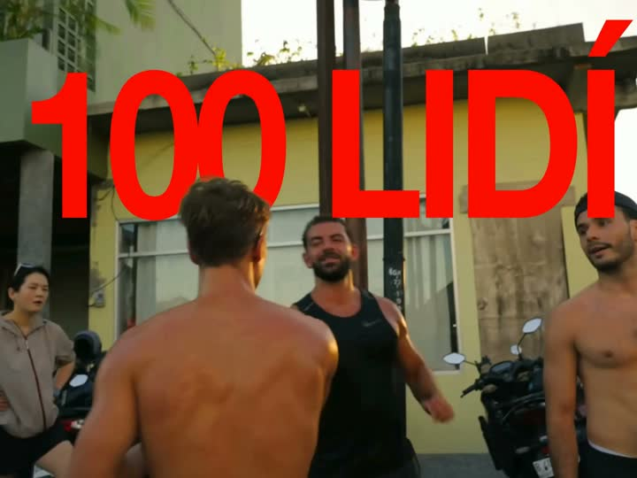
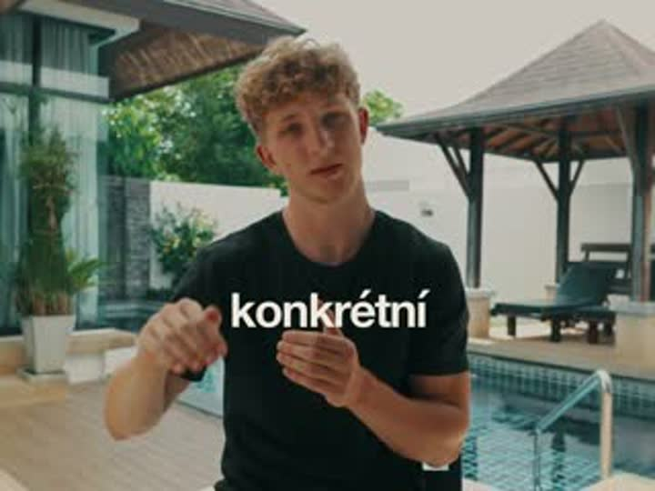
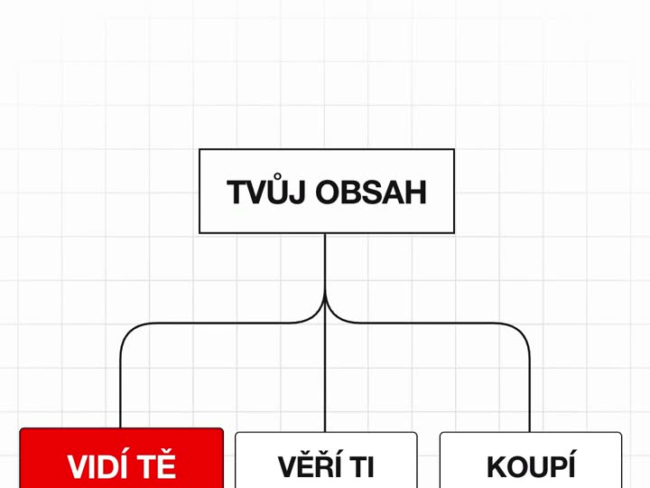
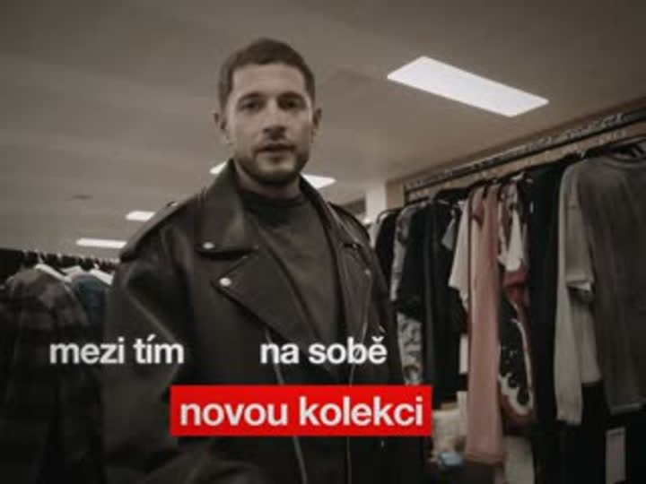
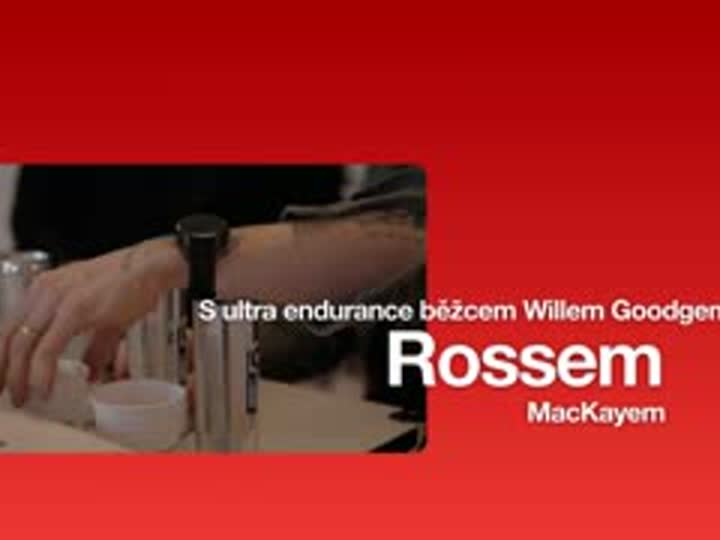
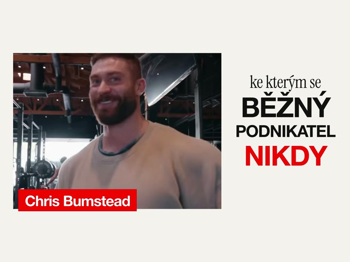
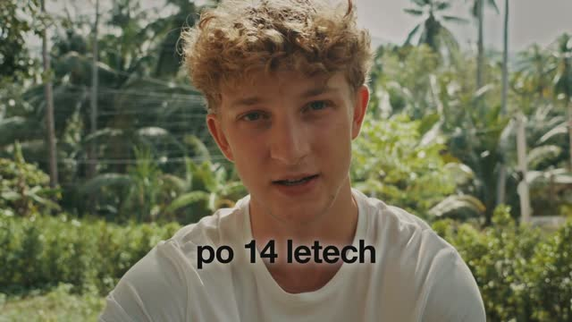

<h1 align="center">beyond / reels</h1>

<p align="center">
  Plugin pro Claude Code, se kterým děláš reely a YouTube edity z vlastního videa.<br>
  Pošleš video a řekneš styl. Claude se doptá, navrhne směry, postaví video, smíchá zvuk a dá ho na revizi.
</p>

<p align="center">
  <a href="#instalace"><b>Instalace</b></a> &nbsp;·&nbsp;
  <a href="docs/NAVOD.md"><b>Návod</b></a> &nbsp;·&nbsp;
  <a href="#styly">Styly</a> &nbsp;·&nbsp;
  <a href="#řešení-problémů">Řešení problémů</a>
</p>

<br>

## Instalace

Potřebuješ Mac s Apple čipem, Claude Code, [Homebrew](https://brew.sh) a kolem 10 GB místa. GitHub účet ne.

**1. Přidej plugin** v Claude Code:

```
/plugin marketplace add StepanKakes/beyond-reels
/plugin install beyond-reels@beyond
```

**2. Spusť setup**, trvá kolem deseti minut. Nainstaluje nástroje a Python, stáhne model pro přepisy a připraví složky:

```bash
zsh ~/.claude/plugins/marketplaces/beyond/plugins/beyond-reels/scripts/setup.sh
```

**3. Restartuj Claude Code** a napiš `/beyond-reels:zacatek`. Provede tě nastavením značky a otevře revizní stránku.

Celý postup, včetně vlastního stylu, je v [návodu](docs/NAVOD.md).

<br>

## Co napsat

Stačí mluvit normálně, příkaz jen určí, který postup se spustí.

| Příkaz | Například |
|---|---|
| `/beyond-reels:zacatek` | „nastav mi značku, tady je logo a písmo“ |
| `/beyond-reels:reel` | „udělej reel ve stylu noske z ~/Downloads/rozhovor.mp4“ |
| `/beyond-reels:revize` | „přečti komentáře k reelu a oprav je“ |
| `/beyond-reels:novy-styl` | „nauč se styl tohohle tvůrce, tady jsou 4 reely“ |
| `/beyond-reels:edits` | „střihni mi to v Edits, video jsem tam nahrál“ |

`/edits` je samostatný postup pro appku Edits od Instagramu: hrubý střih, pauzy podle zvuku, titulky, hudba a vyvážený zvuk přímo v Edits přes jeho MCP. Nepotřebuje HyperFrames ani setup, stačí v Edits zkopírovat prompt pro připojení ke Claudovi.

<br>

## Jak vzniká reel

Osm kroků. Ve čtyřech rozhoduješ ty a render přijde až po schváleném storyboardu.

| | Krok | Kdo | Co se děje |
|:-:|---|---|---|
| 1 | **Video a styl** | ty | cesta k videu nebo víc pokusů, o čem to je, jaký styl |
| 2 | **Brief** | Claude | doptá se na typ, délku a konec, založí projekt v `~/Documents/beyond-reely` |
| 3 | **Text, střih a hlas** | Claude | přepis, nejlepší pokusy, hrany do ticha, studio hlas a časy slov |
| 4 | **Výběr směrů** | ty | u každé důležité věty dvě až tři varianty |
| 5 | **Storyboard** | ty | statické snímky ke schválení na revizní stránce |
| 6 | **Stavba a zvuk** | Claude | kompozice, titulky ze slov, mix na -14 LUFS |
| 7 | **Revize** | ty | komentáře přímo k času, kresba přes snímek, oprava titulku na `localhost:4747` |
| 8 | **Opravy a učení** | Claude | nová verze, odpověď u každého komentáře a verdikt, ze kterého se učí další reely |

<br>

## Styly

Sedm hotových stylů, každý s vlastním skillem a kitem. Jsou to vlastní verze podle řemesla tvůrců, po kterých se jmenují, a s těmi tvůrci nejsou nijak spojené. Barvy a písma se nastaví podle tvé značky.

<table>
  <tr>
    <td width="33%" valign="top"><br><b>Mason</b><br><sub>Grafika na každou frázi, případovky, slovo za osobou</sub></td>
    <td width="33%" valign="top"><br><b>Noske</b><br><sub>Filmový talking head, titulky po slově</sub></td>
    <td width="33%" valign="top"><br><b>Matt Gray</b><br><sub>Diagram nahoře, webka dole, roste s řečí</sub></td>
  </tr>
  <tr>
    <td valign="top"><br><b>Lumitris</b><br><sub>Rychlý dokumentární edit, trhaný takt</sub></td>
    <td valign="top"><br><b>Nathan</b><br><sub>Klidný, velké slovo, B-rolly v oknech</sub></td>
    <td valign="top"><br><b>Caspar</b><br><sub>Důraz typografií, karty, B-rolly lidí z příběhu</sub></td>
  </tr>
  <tr>
    <td valign="top"><br><b>SooWei</b><br><sub>YouTube 16:9, čisté střihy se zoomem, karta s kroky</sub></td>
    <td valign="top"><br><b>Tvůj styl</b><br><sub><code>/beyond-reels:novy-styl</code> se ho naučí z odkazů na reely, které se ti líbí</sub></td>
  </tr>
</table>

<br>

## Hudba, záběry a práva

Plugin nenese žádnou hudbu ani B-rolly. Dodáváš je sám a musíš mít právo je použít. To samé platí pro zdrojová videa, loga a vlastní písma.
`/novy-styl` stahuje cizí videa jen k rozboru na tvůj disk, do hotového reelu z nich nic nepatří. Helvetica Neue se bere ze systému tvého Macu, plugin ji nešíří.

<br>

## Řešení problémů

| Problém | Řešení |
|---|---|
| Claude o pluginu neví | `/plugin`, záložka Installed, případně restart Claude Code |
| Chybí nástroj nebo cesta | spusť `setup.sh --kontrola`, řekne co chybí, pak setup bez parametru |
| Revize se neotevře | řekni Claudovi „otevři revizi“; když je port obsazený, nastav jiný v `BR_REVIZE_PORT` |
| Reel má špatné barvy nebo písmo | značka platí jen pro nové projekty, u rozdělaného řekni „dosaď značku do tohoto projektu“ |
| Nová verze pluginu | `/plugin`, Marketplaces, beyond, Update, pak restart. Tvoje složka `_moje` zůstane |

<br>

## Co je kde

```
plugins/beyond-reels/
  skills/        průvodce reelem, začátek, revize, nový styl a jazyk každého stylu
  agents/        overovac (kontrola renderu) a rozbor (rozbor reference)
  prostor/       jádro kitů, kity stylů, nástroje (studio hlas, mix, zarovnání slov,
                 kontrola střihu), SFX, vzory a lokální revize
  scripts/       setup, založení reelu, šablona projektu, stahování videí
  vkus/          výchozí pravidla vkusu a prace.md: jak Claude dělí práci mezi agenty
docs/NAVOD.md    návod krok za krokem
```

Mimo plugin: reely v `~/Documents/beyond-reely`, tvoje věci v `~/Documents/beyond-reely/_moje` (značka, vkus, vlastní styly, hudba, B-rolly, data revize).

Křivky pohybu v jádře vycházejí z motionmaxxing (Apache 2.0, viz `prostor/jadro/NOTICE`). Plugin nenese API klíče a posílá data revize jen na tvůj počítač.

<br>

<p align="center"><sub>Beyond · reely v HyperFrames · verze 1.0</sub></p>
